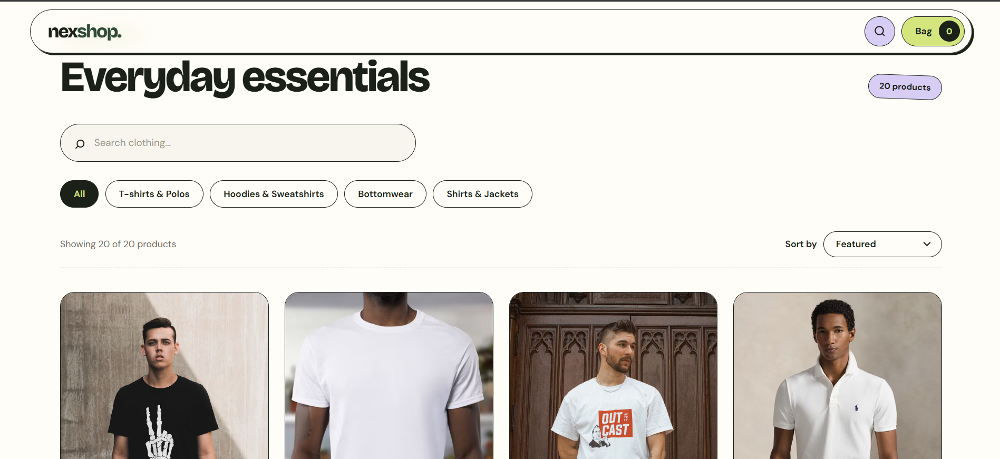
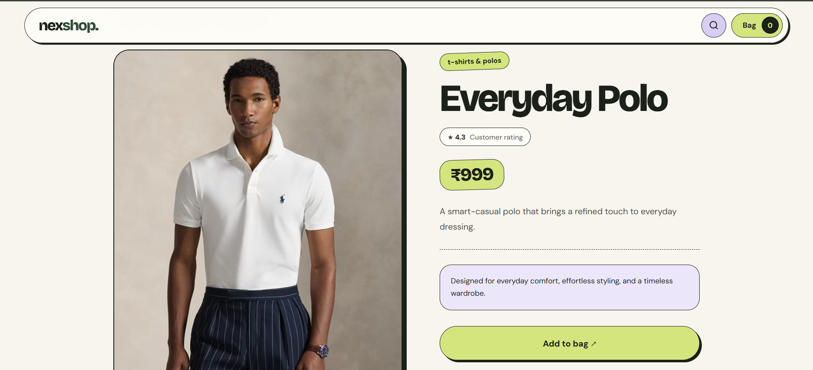
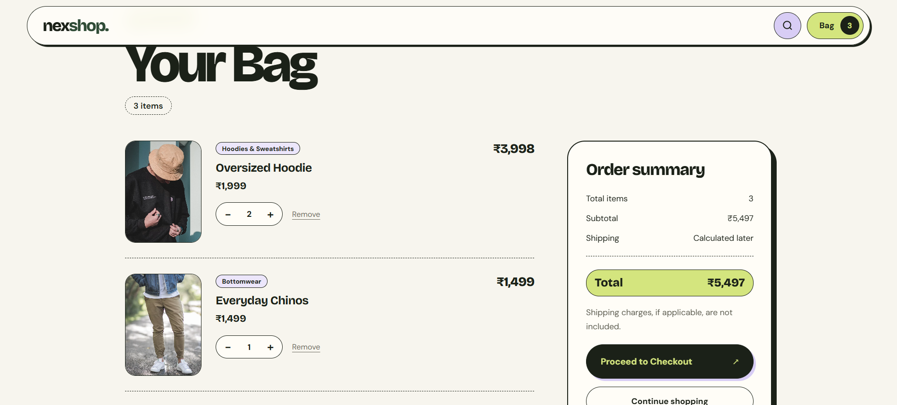

# Nexshop

A responsive clothing storefront built with React, Vite, and React Router. Browse a local product catalog, search and filter products, view product details, and manage a shopping bag saved in the browser.

## Requirements

- Node.js 20.19+ or 22.12+
- npm

## Run locally

```sh
npm install
npm run dev
```

Vite prints the local development URL after startup.

## Available commands

| Command | Description |
| --- | --- |
| `npm run dev` | Start the development server |
| `npm run build` | Create the production build in `dist/` |
| `npm run preview` | Preview the production build locally |
| `npm run lint` | Run ESLint |
| `npm test` | Run the Node.js unit tests |

## Features

- Product search and category filters
- Product details with add-to-bag controls
- Bag quantity management and subtotal calculation
- Browser local storage persistence, with a visible notice if stored data cannot be recovered or saved
- Shared navigation and a not-found page
- Local image fallback when a remote product image is unavailable

Products are defined in [`src/data/products.json`](./src/data/products.json). Product photos are loaded from Unsplash and require an internet connection; the storefront uses a local placeholder if a remote image fails.

## Screenshots

### Home Page


### Product Details


### Shopping Bag



## Project Structure

```text
nexshop/
├── public/
│   ├── favicon.svg
│   ├── icons.svg
│   └── product-placeholder.svg
├── screenshots/
│   ├── home.png
│   ├── product-details.png
│   └── cart.png
├── src/
│   ├── assets/
│   ├── components/
│   ├── context/
│   ├── data/
│   ├── pages/
│   ├── App.jsx
│   ├── App.css
│   ├── index.css
│   └── main.jsx
├── tests/
├── .gitignore
├── package.json
├── README.md
└── vite.config.js
```

## Tech Stack

- **Frontend:** React.js, JavaScript, HTML5, CSS3
- **Build Tool:** Vite
- **Routing:** React Router
- **State Management:** React Context API
- **Storage:** Browser Local Storage
- **Testing:** Node.js Test Runner

## Testing

Run the following command to execute the unit tests:

```bash
npm test
```

## Future Improvements

- User authentication
- Backend and database integration
- Payment gateway integration
- Order management
- Product administration
```

These future improvements are ideas, not features currently implemented.

## Step 7E: Save and verify

Check that:
- All three screenshots display.
- Project structure matches your actual folders.
- Commands are correctly formatted.
- No broken image links appear.

**Once done, tell me.** Next we'll run the tests and production build before pushing the updated README and screenshots to GitHub.